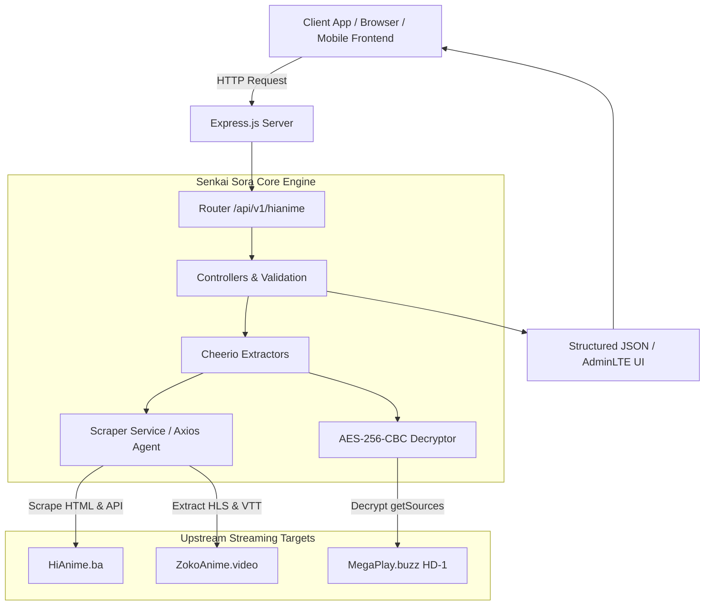

# 🌌 HiAnime Unofficial API by Senkai Sora — High-Performance Anime Scraper & Stream Extraction Engine

[](https://expressjs.com/)
[](https://www.typescriptlang.org/)
[](https://nodejs.org/)
[](https://bun.sh/)
[](https://cheerio.js.org/)
[](https://axios-http.com/)
[](LICENSE)

**Hianime Unofficial Api by Senkai Sora** is a high-performance, structured anime scraping and streaming extraction engine built with **Express.js**, **TypeScript**, and **Cheerio**. It transforms [hianime.ba](https://hianime.ba) data into type-safe REST APIs and features stream extractors capable of resolving direct Master `.m3u8` playlists, VTT subtitle tracks, and intro/outro timestamps with AES-256-CBC decryption.

---

## 📑 Table of Contents

- [Features](#-features)
- [Architecture Overview](#-architecture-overview)
- [Interactive AdminLTE Dashboard](#-interactive-adminlte-dashboard)
- [Getting Started](#-getting-started)
- [Environment Variables](#-environment-variables)
- [Stream Extraction & AES-256 Decryption](#-stream-extraction--aes-256-decryption)
- [API Reference & Endpoints](#-api-reference--endpoints)
  - [1. HiAnime Home Feed](#1-hianime-home-feed)
  - [2. Anime Details](#2-anime-details)
  - [3. Anime Episodes List](#3-anime-episodes-list)
  - [4. Episode Streaming Servers](#4-episode-streaming-servers)
  - [5. Episode Downloads](#5-episode-downloads)
  - [6. ZokoAnime Stream Extractor](#6-zokoanime-stream-extractor)
  - [7. HD-1 (MegaPlay) Stream Extractor](#7-hd-1-megaplay-stream-extractor)
  - [8. Random Anime](#8-random-anime)
  - [9. Instant Search Suggestions](#9-instant-search-suggestions)
  - [10. Search Anime Catalog](#10-search-anime-catalog)
  - [11. Genre Filter](#11-genre-filter)
  - [12. A–Z Catalog Directory](#12-az-catalog-directory)
  - [13. Service Diagnostics & Health](#13-service-diagnostics--health)
- [Project Structure](#-project-structure)
- [Deployment](#-deployment)
- [License & Disclaimer](#-license--disclaimer)

---

## ⚡ Features

- **🚀 Ultra-Fast Server-Side Scraping:** Utilizes Cheerio and persistent Axios HTTP agents with zero headless browser overhead, achieving sub-second responses.
- **🛡️ Native AES-256-CBC Decryption:** Deobfuscates encrypted video source payloads (`enc`) from server `HD-1` (`megaplay.buzz`) with built-in cryptographic primitives.
- **🎬 Direct HLS (M3U8) & Subtitles:** Extracts direct multi-bitrate Master `.m3u8` streams, `.vtt` subtitle files, and precise intro/outro skip intervals for ZokoAnime and MegaPlay servers.
- **🔓 Base64 Server Decoding:** Automatically decodes Base64 stream URLs into direct playable stream embeds for Sub, Dub, and Raw categories.
- **🖥️ AdminLTE Interactive Frontpage:** Sleek AdminLTE dark-mode testing console available directly at root (`GET /`) for one-click endpoint testing and raw JSON inspection.
- **🔍 Typeahead & Deep Search:** Real-time search suggestions with poster cards, comprehensive catalog search with full pagination, and genre / A–Z catalog browsing.
- **📦 Dual Runtime Support:** Compatible with both Node.js (v18+) and Bun (v1.4+) for fast cold starts and development.
- **🌐 Full CORS & JSON Ready:** Ready to be consumed by Next.js, React, React Native, Flutter, Swift, or Android applications.

---

## 🏗️ Architecture Overview



---

## 🖥️ Interactive AdminLTE Dashboard

The root path (`GET /`) serves an **AdminLTE v3** styled dark interactive developer dashboard designed specifically for inspecting and testing every API route:

- **Sidebar Treeview Navigation**: Browse all 13 endpoints organized by category (Home & Catalog, Anime & Episodes, Stream Extractors, Search & Discovery, Diagnostics).
- **Dynamic Parameter Fields**: Modify queries (`episodeId`, `keyword`, `genre`, `page`, `url`) with pre-filled working defaults.
- **Quick Preset Chips**: One-click instant testing buttons (e.g. *One Piece*, *Naruto*, *Action Genre*, *MegaPlay HD-1 Stream*).
- **Raw JSON Console**: Syntax-highlighted response viewer with status codes, latency calculation (`ms`), payload size (`KB`), and one-click JSON clipboard copying.

> [!NOTE]
> When requesting `GET /` with header `Accept: application/json` or query parameter `?format=json`, the server automatically returns the raw JSON endpoint directory for programmatic consumers.

---

## 🚀 Getting Started

### Prerequisites

- [Node.js](https://nodejs.org/) v18.18.0 or later *(or [Bun](https://bun.sh/) v1.4.0+)*
- npm, yarn, or bun package manager

### Installation

```bash
# Clone repository
git clone https://github.com/NicoLoop/anime-stream-gb.git
cd anime-stream-gb/api

# Install dependencies
npm install
# or with Bun:
bun install
```

### Running Locally

```bash
# Start in development mode with hot reload
npm run dev

# Or with Bun:
npm run dev:bun

# Compile TypeScript to dist/
npm run build

# Start production server
npm start
```

Open [http://localhost:4000](http://localhost:4000) in your browser to access the AdminLTE API testing console.

---

## ⚙️ Environment Variables

Create a `.env` file in the `api/` root directory (or copy `.env.example`):

```env
# Server Port (Default: 4000)
PORT=4000

# Base URL of Upstream HiAnime Target
BASE_URL=https://hianime.ba
```

---

## 🎬 Stream Extraction & AES-256 Decryption

The API includes specialized direct stream extractors:

### 1. HD-1 (MegaPlay) Cryptographic Decryption
- **Embed URL**: `https://megaplay.buzz/stream/s-2/2142/sub?s=tcdn`
- **Internal Payload**: Player embeds `<div id="megaplay-player" data-id="...">` which calls `https://megaplay.buzz/stream/getSources?id=...`.
- **Cipher**: Returns an obfuscated ciphertext (`enc`) encrypted using **AES-256-CBC**.
- **Decryption Engine**: Automatically derives key and IV, performs URL-safe Base64 padding normalization, and outputs decrypted JSON containing the direct Master `.m3u8` playlist URL and subtitle tracks.

### 2. ZokoAnime Payload Deobfuscation
- **Embed URL**: `https://zokoanime.video/stream/mal/21/1/sub`
- **Extractor**: Extracts video source objects, Master HLS streams, webvtt subtitle tracks (`.vtt`), and auto-skip ranges for anime intros and outros.

---

## 📡 API Reference & Endpoints

### 1. HiAnime Home Feed
- **Method**: `GET`
- **URL**: `/api/v1/hianime/home`
- **Description**: Returns all sections from HiAnime's homepage (`https://hianime.ba/home`), including spotlight sliders, trending anime, latest episodes, upcoming releases, top airing, top 10 (day, week, month), and genres.

#### Sample Response:
```json
{
  "success": true,
  "data": {
    "spotlightAnimes": [
      {
        "rank": 1,
        "id": "black-clover-season-2-1-10492",
        "name": "Black Clover Season 2",
        "jname": "Black Clover 2nd Season",
        "poster": "https://hianime.ba/storage/media/2026/10/black-clover-season-2-1-banner.webp",
        "description": "The second season of Black Clover.",
        "type": "TV",
        "duration": "Oct 5, 2026",
        "aired": "Oct 5, 2026",
        "quality": "HD",
        "episodes": {
          "sub": 3,
          "dub": 1,
          "eps": 3
        }
      }
    ],
    "trendingAnimes": [
      {
        "rank": 1,
        "id": "one-piece-1",
        "name": "One Piece",
        "jname": "One Piece",
        "poster": "https://hianime.ba/storage/media/2026/08/one-piece.webp"
      }
    ],
    "latestEpisodeAnimes": [ ... ],
    "topUpcomingAnimes": [ ... ],
    "topAiringAnimes": [ ... ],
    "mostPopularAnimes": [ ... ],
    "mostFavoriteAnimes": [ ... ],
    "latestCompletedAnimes": [ ... ],
    "top10Animes": {
      "today": [ ... ],
      "week": [ ... ],
      "month": [ ... ]
    },
    "genres": [ "Action", "Adventure", "Comedy", "Drama", "Fantasy", ... ]
  }
}
```

---

### 2. Anime Details
- **Method**: `GET`
- **URL**: `/api/v1/hianime/anime/:id` *(or `/api/v1/hianime/animeDetails/:id`)*
- **Example**: `/api/v1/hianime/anime/one-piece-1`
- **Description**: Returns complete details for an anime including overview, stats, japanese/romaji title, poster, genres, producers, studios, recommended anime, related anime, and numeric `animeId`.

#### Sample Response:
```json
{
  "success": true,
  "data": {
    "id": "one-piece-1",
    "animeId": "1",
    "name": "One Piece",
    "jname": "ONE PIECE",
    "poster": "https://hianime.ba/storage/media/2026/08/one-piece.webp",
    "description": "Gold Roger was known as the 'Pirate King'...",
    "stats": {
      "rating": "PG-13",
      "quality": "HD",
      "type": "TV",
      "duration": "24m",
      "episodes": {
        "sub": 1180,
        "dub": 1155,
        "eps": 1180
      }
    },
    "moreInfo": {
      "japanese": "ONE PIECE",
      "synonyms": null,
      "aired": "Oct 20, 1999 to ?",
      "premiered": null,
      "duration": "24m",
      "status": "Currently Airing",
      "malScore": "8.73",
      "genres": ["Adventure", "Fantasy", "Shounen", "Comedy", "Drama", "Super Power", "Action"],
      "studios": ["Toei Animation"],
      "producers": ["Fuji TV", "Shueisha", "Funimation", "Toei Animation"]
    },
    "recommendedAnimes": [ ... ],
    "relatedAnimes": [ ... ],
    "mostPopularAnimes": [ ... ]
  }
}
```

---

### 3. Anime Episodes List
- **Method**: `GET`
- **URL**: `/api/v1/hianime/episodes/:id` *(or `/api/v1/hianime/anime/:id/episodes`)*
- **Example**: `/api/v1/hianime/episodes/1` or `/api/v1/hianime/episodes/one-piece-1`
- **Description**: Scrapes HiAnime's episode list (`https://hianime.ba/api/theme/episode/list/[anime id]`). Accepts both numeric anime IDs (e.g., `1`, `10492`) or slug IDs (e.g., `one-piece-1`).

#### Sample Response:
```json
{
  "success": true,
  "data": {
    "animeId": "1",
    "totalEpisodes": 1180,
    "episodes": [
      {
        "title": "Episode 1",
        "episodeId": "1",
        "number": 1,
        "name": "Episode 1",
        "isFiller": false,
        "url": "https://hianime.ba/watch/one-piece-1?ep=1"
      },
      {
        "title": "Episode 2",
        "episodeId": "2",
        "number": 2,
        "name": "Episode 2",
        "isFiller": false,
        "url": "https://hianime.ba/watch/one-piece-1?ep=2"
      }
    ]
  }
}
```

---

### 4. Episode Streaming Servers
- **Method**: `GET`
- **URL**: `/api/v1/hianime/servers?episodeId=:id` *(or `/api/v1/hianime/servers/:id`)*
- **Example**: `/api/v1/hianime/servers?episodeId=1`
- **Description**: Scrapes available streaming servers from `https://hianime.ba/api/theme/episode/servers?episodeId=1`. Automatically decodes the Base64 embed/stream URL for immediate streaming playback.

#### Sample Response:
```json
{
  "success": true,
  "data": {
    "episodeId": "1",
    "sub": [
      {
        "serverName": "ZokoAnime",
        "type": "sub",
        "hash": "aHR0cHM6Ly96b2tvYW5pbWUudmlkZW8vc3RyZWFtL21hbC8yMS8xL3N1Yg==",
        "streamUrl": "https://zokoanime.video/stream/mal/21/1/sub"
      },
      {
        "serverName": "HD-1",
        "type": "sub",
        "hash": "aHR0cHM6Ly9tZWdhcGxheS5idXp6L3N0cmVhbS9zLTIvMjE0Mi9zdWI/cz10Y2Ru",
        "streamUrl": "https://megaplay.buzz/stream/s-2/2142/sub?s=tcdn"
      }
    ],
    "dub": [
      {
        "serverName": "ZokoAnime",
        "type": "dub",
        "hash": "aHR0cHM6Ly96b2tvYW5pbWUudmlkZW8vc3RyZWFtL21hbC8yMS8xL2R1Yg==",
        "streamUrl": "https://zokoanime.video/stream/mal/21/1/dub"
      },
      {
        "serverName": "HD-1",
        "type": "dub",
        "hash": "aHR0cHM6Ly9tZWdhcGxheS5idXp6L3N0cmVhbS9zLTIvMjE0Mi9kdWI/cz10Y2Ru",
        "streamUrl": "https://megaplay.buzz/stream/s-2/2142/dub?s=tcdn"
      }
    ],
    "raw": []
  }
}
```

---

### 5. Episode Downloads
- **Method**: `GET`
- **URL**: `/api/v1/hianime/downloads?episodeId=:id` *(or `/api/v1/hianime/downloads/:id`)*
- **Example**: `/api/v1/hianime/downloads?episodeId=1`
- **Description**: Scrapes episode download links from `https://hianime.ba/api/theme/episode/downloads?episodeId=1`. Returns categorized groups (e.g. Kiwi Sub with 360p, 720p, 1080p) as well as flat download links.

#### Sample Response:
```json
{
  "success": true,
  "data": {
    "episodeId": "1",
    "groups": [
      {
        "groupName": "Kiwi Sub",
        "links": [
          {
            "quality": "720p",
            "url": "https://pahe.nekostream.site/EqmUA"
          },
          {
            "quality": "1080p",
            "url": "https://pahe.nekostream.site/fmkoo"
          }
        ]
      }
    ],
    "downloads": [
      {
        "source": "Kiwi Sub",
        "quality": "720p",
        "url": "https://pahe.nekostream.site/EqmUA"
      },
      {
        "source": "Kiwi Sub",
        "quality": "1080p",
        "url": "https://pahe.nekostream.site/fmkoo"
      }
    ]
  }
}
```

---

### 6. ZokoAnime Stream Extractor
- **Method**: `GET` or `POST`
- **URL**:
  - `GET /api/v1/hianime/stream/zokoanime?url=:streamUrl`
  - `GET /api/v1/hianime/stream/zokoanime/:provider/:id/:ep/:category`
  - `POST /api/v1/hianime/stream/zokoanime` with `{ "url": "..." }`
- **Example**: `/api/v1/hianime/stream/zokoanime?url=https://zokoanime.video/stream/mal/21/1/sub`
- **Description**: Deobfuscates and extracts ZokoAnime player payload. Delivers the direct Master `.m3u8` HLS streaming URL, VTT subtitle tracks, and intro/outro timestamps.

#### Sample Response:
```json
{
  "success": true,
  "data": {
    "streamingLink": "https://zokoanime.video/stream/mal/21/1/sub",
    "sources": [
      {
        "url": "https://hls.dramahot.top/p/scxqicy/ta9t4m1bhw/cm72fkvbpx/09qmw7k6mi5nzd/master.m3u8",
        "isM3U8": true
      }
    ],
    "m3u8": "https://hls.dramahot.top/p/scxqicy/ta9t4m1bhw/cm72fkvbpx/09qmw7k6mi5nzd/master.m3u8",
    "subtitles": [
      {
        "lang": "en",
        "label": "English",
        "default": true,
        "src": "https://hls.dramahot.top/v/scxqicy/ta9t4m1bhw/cm72fkvbpx/09qmw7k6mi5nzd/subs/6e4a0p3k8ehe9eee.vtt"
      }
    ],
    "intro": {
      "start": 31,
      "end": 111
    },
    "outro": {
      "start": 1376,
      "end": 1447
    },
    "downloadUrl": "https://zokoanime.video/download/mal/21/1/sub"
  }
}
```

---

### 7. HD-1 (MegaPlay) Stream Extractor
- **Method**: `GET` or `POST`
- **URL**:
  - `GET /api/v1/hianime/stream/hd-1?url=:streamUrl`
  - `GET /api/v1/hianime/stream/hd-1?hash=:base64Hash`
  - `GET /api/v1/hianime/stream/hd-1/:id/:category`
  - `POST /api/v1/hianime/stream/hd-1` with `{ "url": "..." }` or `{ "hash": "..." }`
- **Aliases**: `/api/v1/hianime/stream/megaplay`
- **Example**: `/api/v1/hianime/stream/hd-1?url=https://megaplay.buzz/stream/s-2/2142/sub?s=tcdn`
- **Description**: Resolves and decrypts the encrypted video source payload from server `HD-1` (`megaplay.buzz`). Uses AES-256-CBC deobfuscation to yield the direct Master `.m3u8` HLS playlist URL, VTT subtitle tracks, and exact intro/outro skip intervals.

#### Sample Response:
```json
{
  "success": true,
  "data": {
    "server": "HD-1 (MegaPlay)",
    "streamingLink": "https://megaplay.buzz/stream/s-2/2142/sub?s=tcdn",
    "sources": [
      {
        "url": "https://fetch.nexabloom.top/anime/f899139df5e1059396431415e770c6dd/61b87186ab260d05003427e16ccf5657/master.m3u8",
        "isM3U8": true
      }
    ],
    "m3u8": "https://fetch.nexabloom.top/anime/f899139df5e1059396431415e770c6dd/61b87186ab260d05003427e16ccf5657/master.m3u8",
    "subtitles": [
      {
        "lang": "English",
        "label": "English",
        "default": true,
        "src": "https://6a8y6.broforgotsave.online/anime/f899139df5e1059396431415e770c6dd/61b87186ab260d05003427e16ccf5657/subtitles/eng-2.vtt"
      }
    ],
    "intro": {
      "start": 31,
      "end": 111
    },
    "outro": {
      "start": 1376,
      "end": 1447
    }
  }
}
```

---

### 8. Random Anime
- **Method**: `GET`
- **URL**: `/api/v1/hianime/random`
- **Description**: Follows the redirect from `https://hianime.ba/random` to fetch and return the complete details of a random anime along with the redirected URL.

---

### 9. Instant Search Suggestions
- **Method**: `GET`
- **URL**: `/api/v1/hianime/search/suggestions?keyword=:keyword`
- **Example**: `/api/v1/hianime/search/suggestions?keyword=naruto`
- **Description**: Scrapes instant autocomplete search suggestions from `https://hianime.ba/api/theme/search/suggestions?keyword=naruto`.

#### Sample Response:
```json
{
  "success": true,
  "data": {
    "keyword": "naruto",
    "suggestions": [
      {
        "id": "naruto-shippuden-355",
        "name": "Naruto: Shippuuden",
        "jname": "ナルト- 疾風伝",
        "poster": "https://hianime.ba/storage/media/2026/08/naruto-shippuden.webp",
        "moreInfo": ["Feb 15, 2007", "TV", "23m"]
      }
    ]
  }
}
```

---

### 10. Search Anime Catalog
- **Method**: `GET`
- **URL**: `/api/v1/hianime/search?keyword=:keyword&page=1`
- **Example**: `/api/v1/hianime/search?keyword=naruto&page=1`
- **Description**: Searches anime catalog from `https://hianime.ba/browse?keyword=naruto` with full pagination (`currentPage`, `totalPages`, `hasNextPage`) and list of anime cards.

---

### 11. Genre Filter
- **Method**: `GET`
- **URL**: `/api/v1/hianime/genres/:genre?page=1`
- **Example**: `/api/v1/hianime/genres/action?page=1`
- **Description**: Scrapes anime by genre from `https://hianime.ba/genres/action` with pagination.

---

### 12. A–Z Catalog Directory
- **Method**: `GET`
- **URL**: `/api/v1/hianime/az-list/:letter?page=1`
- **Example**: `/api/v1/hianime/az-list/a?page=1`
- **Description**: Scrapes alphabetical listing from `https://hianime.ba/az-list/a` (supports letters `a-z`, `0-9`, `other`, `all`).

---

### 13. Service Diagnostics & Health
- **Method**: `GET`
- **URL**: `/health`
- **Description**: Returns process uptime, status, and server timestamp.

```json
{
  "status": "ok",
  "uptime": 142.3,
  "timestamp": "2026-10-17T23:58:00.000Z"
}
```

---

## 📂 Project Structure

```
api/
├── src/
│   ├── config/             # Environment configuration (PORT, BASE_URL)
│   ├── controllers/        # Request controllers for home, anime, episodes, streams
│   │   ├── home.controller.ts
│   │   ├── detail.controller.ts
│   │   ├── episode.controller.ts
│   │   ├── server.controller.ts
│   │   ├── download.controller.ts
│   │   ├── zoko.controller.ts
│   │   ├── megaplay.controller.ts
│   │   ├── random.controller.ts
│   │   ├── search.controller.ts
│   │   ├── genre.controller.ts
│   │   └── az.controller.ts
│   ├── extractors/         # Cheerio parsers and crypto decryptors
│   │   ├── home.extractor.ts
│   │   ├── detail.extractor.ts
│   │   ├── episode.extractor.ts
│   │   ├── server.extractor.ts
│   │   ├── download.extractor.ts
│   │   ├── zoko.extractor.ts
│   │   ├── megaplay.extractor.ts
│   │   ├── search.extractor.ts
│   │   └── list.extractor.ts
│   ├── routes/             # Express route definitions
│   │   ├── index.ts
│   │   ├── home.routes.ts
│   │   └── anime.routes.ts
│   ├── services/           # Axios scraper service with retry mechanisms
│   │   └── scraper.service.ts
│   ├── types/              # Comprehensive TypeScript interfaces
│   │   └── anime.ts
│   ├── utils/              # Standard JSON response helpers
│   │   └── response.ts
│   ├── views/              # AdminLTE interactive UI template
│   │   └── dashboard.ts
│   ├── app.ts              # Express application setup & middleware
│   └── index.ts            # Server entrypoint
├── .env.example            # Environment variable template
├── package.json
└── tsconfig.json
```

---

## 📦 Deployment

### Deploy on Vercel / Serverless
1. Configure `vercel.json` pointing routes to `src/index.ts` (or `dist/index.js`).
2. Set environment variable `BASE_URL=https://hianime.ba`.
3. Deploy directly via Vercel CLI (`vercel --prod`).

### Deploy with Docker
```dockerfile
FROM node:20-alpine
WORKDIR /app
COPY package*.json ./
RUN npm ci --only=production
COPY dist ./dist
EXPOSE 4000
CMD ["node", "dist/index.js"]
```

### Deploy on Railway / Render / VPS (PM2)
```bash
# Build production bundle
npm run build

# Start using PM2
pm2 start dist/index.js --name "senkai-sora-api"
```

---

## 📄 License & Disclaimer

This project is licensed under the MIT License — see the [LICENSE](LICENSE) file for details. Built purely for educational, non-commercial streaming and scraping research. All anime metadata, imagery, and streams are property of their respective creators and distributors.
